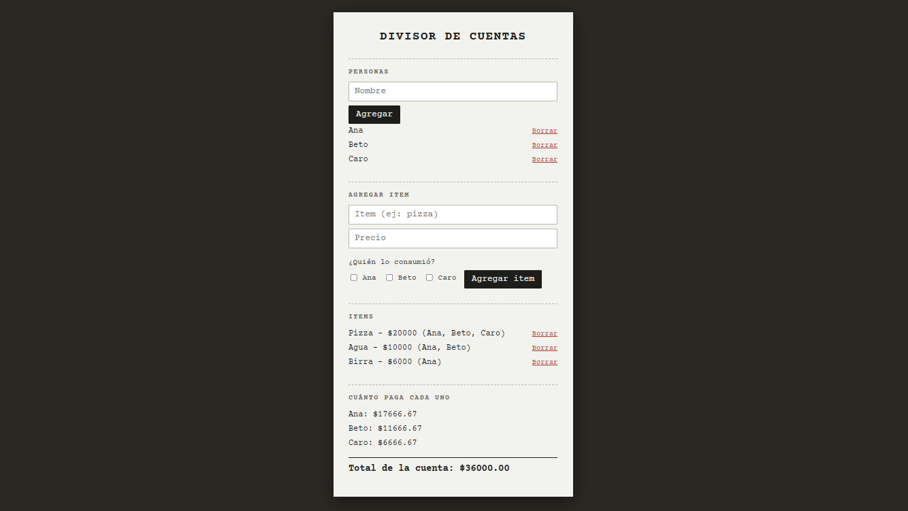

# Divisor de cuentas

App web para repartir la cuenta de una comida entre varias personas, incluso cuando no todos consumieron lo mismo. Una pizza se divide entre todos, pero la bebida que pidió uno solo la paga solo esa persona.



## Qué hace

- Cargás las personas de la mesa.
- Cargás cada item con su precio y marcás quiénes lo consumieron. El precio se reparte en partes iguales entre esas personas.
- Ves en tiempo real cuánto paga cada uno y el total de la cuenta.
- Si borrás a una persona, se la saca también de los items en los que figuraba, y los totales se recalculan solos.
- Si un item queda sin consumidores, la app muestra cuánto dinero quedó **sin asignar**, para que la cuenta nunca "pierda" plata en silencio.

## Ejemplo

| Item    | Precio | Consumieron     |
| ------- | -----: | -------------   |
| Pizza   | $20000 | Ana, Beto, Caro |
| Agua    | $10000 | Ana, Beto       |
| Birra   | $6000  | Ana             |

| Persona | Paga       |
| ------- | ---------: |
| Ana     | $17666.67  |
| Beto    | $11666.67  |
| Caro    | $6666.67   |

Los montos se muestran con dos decimales, así que la suma de los totales individuales puede diferir en un centavo del total de la cuenta por redondeo.

## Tecnologías

- [React](https://react.dev/) con [TypeScript](https://www.typescriptlang.org/)
- [Vite](https://vite.dev/) como herramienta de desarrollo
- ESLint para el análisis del código
- CSS plano, sin librerías de estilos

## Cómo correrlo

Necesitás tener [Node.js](https://nodejs.org/) instalado.

```bash
git clone https://github.com/lunati-luna/Divisor-cuentas.git
cd Divisor-cuentas
npm install
npm run dev
```

Después abrí `http://localhost:5173` en el navegador.

## Estructura

```
src/
├── App.tsx             # Estado principal (personas e items) y composición de la pantalla
├── FormularioItem.tsx  # Formulario para cargar un item y elegir quiénes lo consumieron
├── Resumen.tsx         # Muestra cuánto paga cada uno, el total y lo sin asignar
├── calculos.ts         # Función que reparte cada item entre sus consumidores
└── types.ts            # Tipos Persona e Item
```

## Notas

Los datos viven solo mientras la pestaña está abierta: no se guardan entre sesiones.

## Posibles mejoras

- Editar un item sin tener que borrarlo y volver a cargarlo.
- Sumar propina y repartirla en proporción a lo que consumió cada uno.
- Botón para copiar el resumen y mandarlo por WhatsApp.